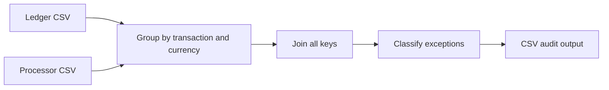

# SQL financial reconciliation

A repeatable **synthetic** reconciliation between a ledger and payment processor. Classifies missing records, duplicate transaction/currency keys and mismatched amounts.


## Architecture



## Run it

```bash
python run.py
```

No third-party Python packages are needed; SQLite runs `reconcile.sql`, checks totals and produces `outputs/reconciliation.csv`.

## Controls

- Group duplicates **before** joining to avoid many-to-many multiplication.
- Report `MATCHED`, `AMOUNT_MISMATCH`, `MISSING_LEDGER`, `MISSING_PROCESSOR` and `DUPLICATE`.
- Store amounts in **integer cents** to avoid rounding errors.
- Check that sum of row variances equals raw ledger total minus processor total.

The sample uses USD only. In a real system, exceptions need analyst review before financial adjustment. This project demonstrates logic; it is not a live banking or employer system.
