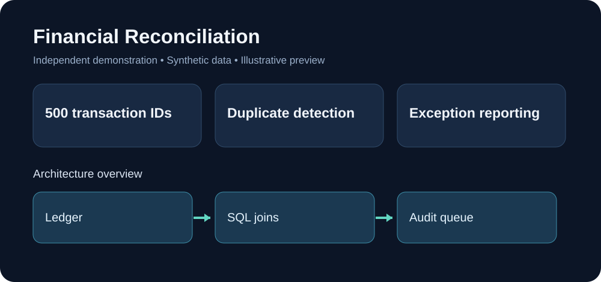
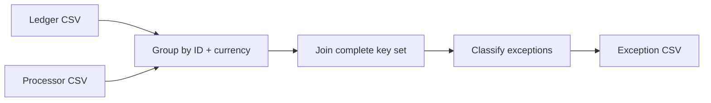

# SQL Financial Reconciliation
**SQL · SQLite · Audit Controls · Python** | Independent portfolio project

Reconcile two synthetic transaction feeds (ledger and processor), detect mismatched totals, missing records, and duplicate transaction keys, then write an exception file for analyst review.



## Business problem
Finance teams need reproducible controls to explain why two independent transaction sources disagree. A naïve join can multiply rows when a transaction ID appears more than once; this demo aggregates each feed by transaction and currency *before* comparing the sources.

## SQL flow


## Run locally
Python 3.10+; only standard-library packages are used.

```bash
python run.py
```

This executes `reconcile.sql` in an in-memory SQLite database, checks that the net variance matches the raw source totals, and writes `outputs/reconciliation.csv` (generated locally, not committed).

## Synthetic reconciliation breakdown

| Status | Transaction keys |
|---|---:|
| Matched | **450** |
| Amount mismatch | **26** |
| Missing in processor | **12** |
| Missing in ledger | **7** |
| Duplicate in either feed | **5** |
| **Total unique keys** | **500** |

**50** transaction keys require review (includes the 5 duplicate cases). Amounts are modeled in integer cents to avoid floating-point reconciliation errors.

## Included files
- `data/ledger.csv`, `data/processor.csv` — synthetic feeds
- `reconcile.sql` — join, aggregation, status classification
- `run.py` — repeatable execution and control-total checks
- `docs/preview.svg` — illustrative control overview

**Scope:** synthetic USD-only exercise, not a live banking control, accounting conclusion, or employer system. Duplicate groups are flagged; they still require an analyst to investigate which side is valid.
